# Imagination Studio for Hermes

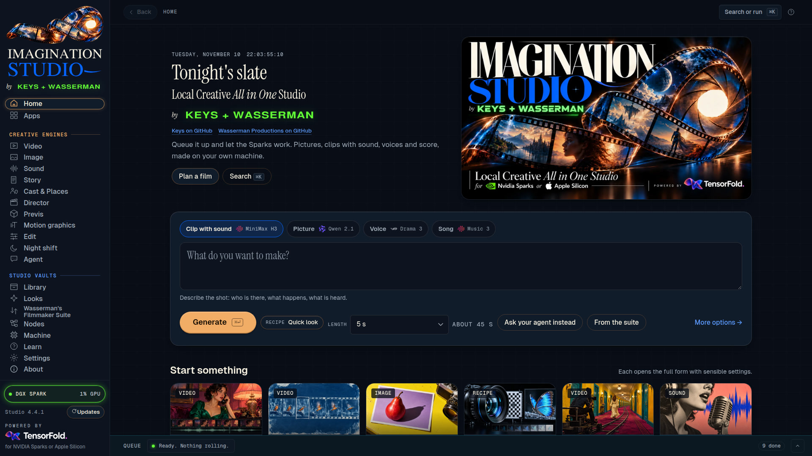

**One plugin, a whole film studio.** Install it and Hermes can direct a complete generative studio on your own
machine: pictures, video clips with sound, voices, songs, sound effects and music videos. Free and open source
(Apache 2.0), like the Studio itself. No cloud, no credits, no subscription.

Make pictures, video clips with sound, voice lines, songs and sound effects **on your own machine**, from any Hermes
chat: the terminal, Desktop, or Telegram and the other messaging apps. The plugin connects Hermes Agent to
[Imagination Studio](https://github.com/drowzeys/Imagination-Studio-by-keys-Wasserman) by keys + Wasserman, a local
AI film studio that runs on NVIDIA DGX Spark, RTX PCs, Windows on ARM and Apple Silicon Macs.

> "Make a picture of a lighthouse in a storm, then a five-second clip of it with the sound of the sea, and a
> thirty-second piano piece to go under it."

Hermes calls the Studio's tools, the Studio renders everything locally in its own queue, and the files come straight
back into the chat.

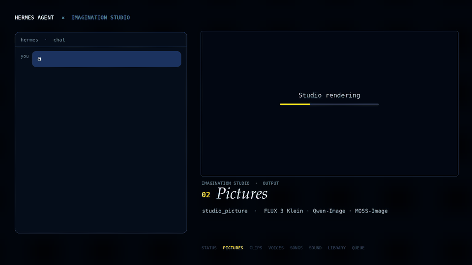

## See each tool at work

Every frame is a real run: the prompt in Hermes, the plugin tool it called (lit up), and what the Studio made.

**Status.** `/studio` calls `studio_status`: what this Studio can make, right now.

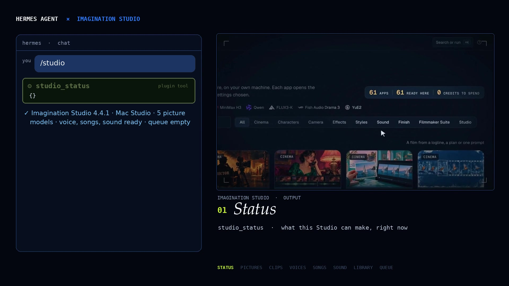

**Pictures.** `studio_picture`, here with Qwen-Image (FLUX 3 Klein and MOSS-Image are there too).

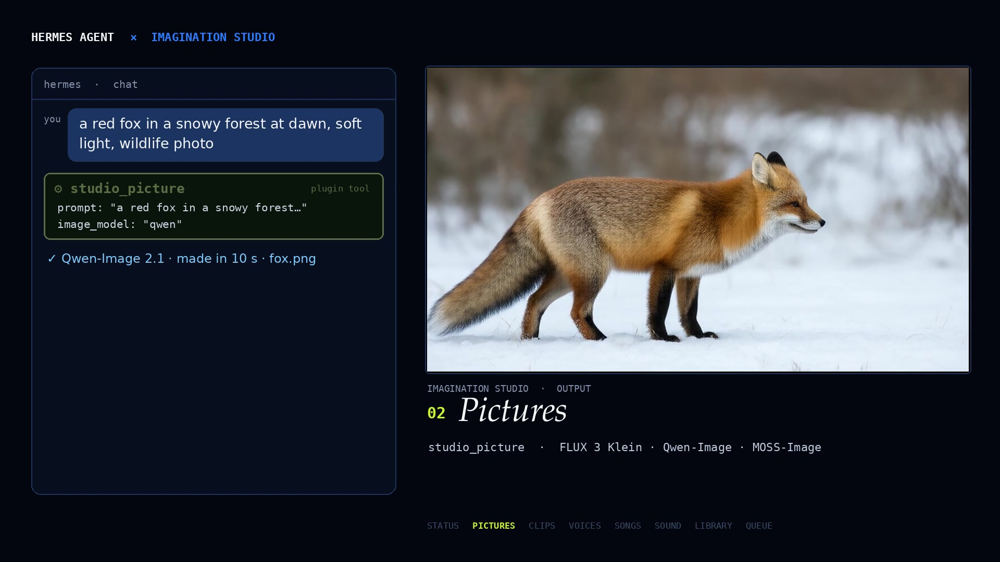

**Clips with sound.** `studio_clip` turns a picture into a clip; `studio_job` picks it up when it is ready.

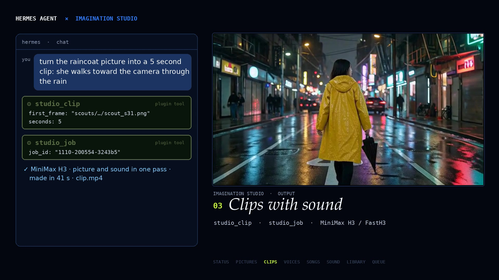

**Voices.** `studio_voice`, any voice from a description (Fish Audio Drama 3).

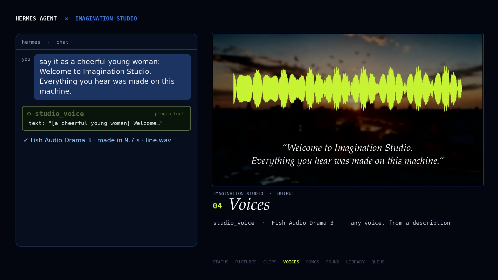

**Songs.** `studio_song`, lyrics and a style in, a finished song out (MiniMax Music 3).

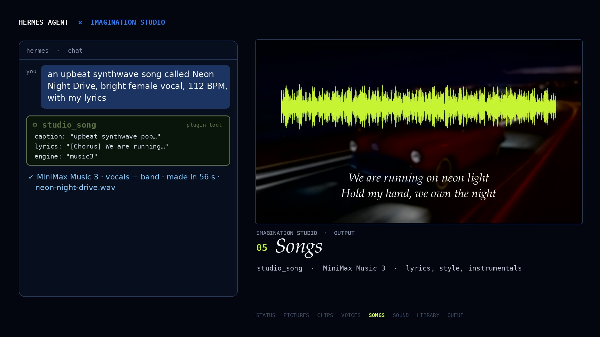

**Sound effects.** `studio_sound`, from a few words (Stable Audio Open).

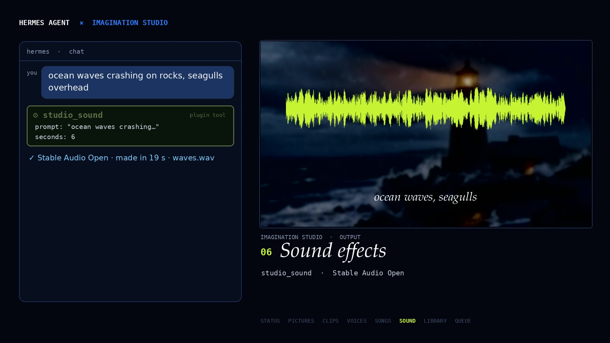

**Library.** `studio_library` finds earlier work and brings it back.

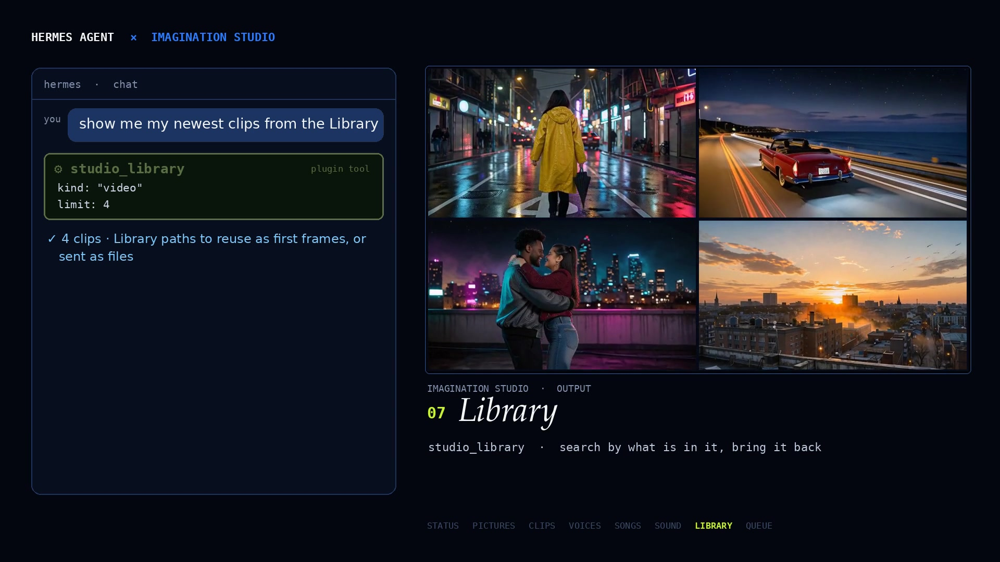

**Queue.** `studio_jobs` lists the queue; `studio_cancel` stops a job before it reaches the GPU.

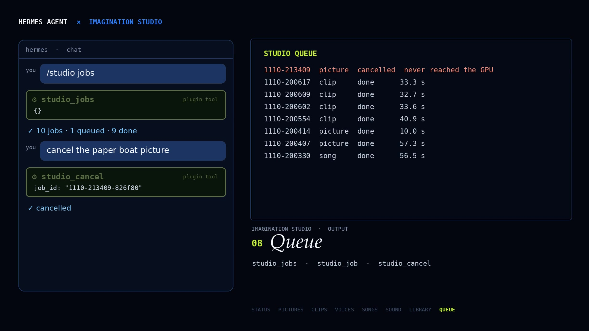

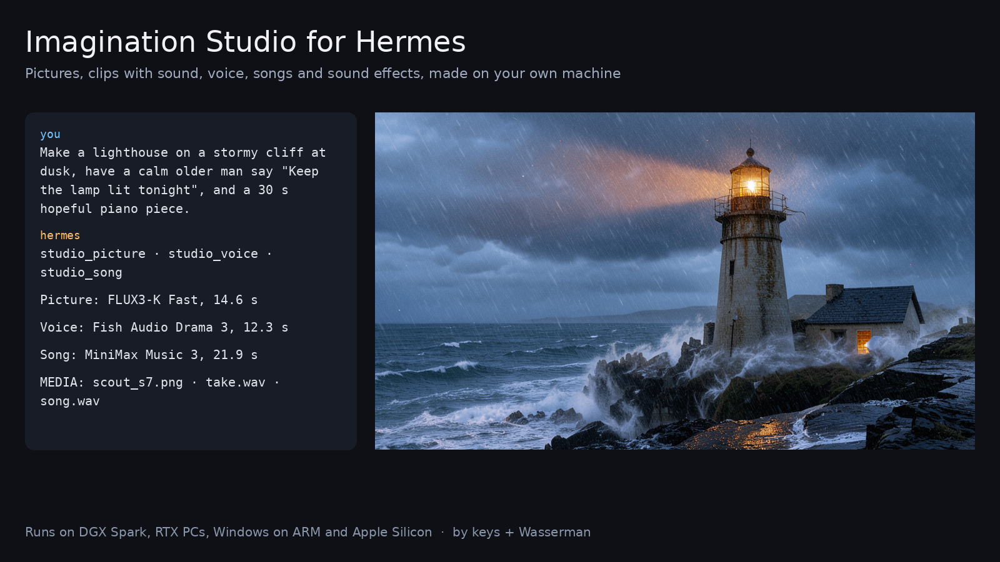

## What Hermes gets

- `studio_status`: what this Studio can make, its licences, its queue, memory and GPU temperature.
- `studio_picture`: still pictures from a prompt (FLUX 3 Image Klein, Qwen-Image 2.1, MOSS-Image).
- `studio_clip`: a video clip with sound, from text, from a picture or from a picture prompt (MiniMax H3 / FastH3).
- `studio_voice`: a spoken line in a described voice (Fish Audio Drama 3).
- `studio_song`: a song from a style and lyrics, or an instrumental (MiniMax Music 3, YuE2 where installed).
- `studio_sound`: a sound effect from words (Stable Audio Open).
- `studio_job`, `studio_jobs`, `studio_cancel`: check, pick up and cancel jobs.
- `studio_library`: search earlier work by what is in it, or bring a file back.

Plus a `/studio` command (status, queue, quick jobs, works in Telegram too) and a bundled skill,
`imagination-studio:imagination-studio`, with prompt advice for each engine.

Long renders don't block the chat: a tool waits up to `wait_seconds` (default 120), then hands back the job id, and
`studio_job` picks the files up when they are ready.

## Install

1. Install and start [Imagination Studio](https://github.com/drowzeys/Imagination-Studio-by-keys-Wasserman) (its
   one-shot setup for your machine). It serves on `http://127.0.0.1:7870`.
2. Install the plugin:

   ```bash
   hermes plugins install imagination-studio --enable      # from the catalog
   # or: hermes plugins install Keys-Wasserman/hermes-imagination-studio --enable
   ```

3. Ask Hermes for something: "make a 6 second sound of rain on a tin roof".

### A Studio on another machine

Point the plugin at it and give it the Studio's access key (from the Studio's Settings page, or
`~/ImaginationStudio/access-key` on that machine):

```bash
hermes config set plugins.entries.imagination-studio.settings.studio_url http://192.168.1.50:7870
```

and set **Studio access key** on the plugin's page in Desktop (Settings → Plugins), or put
`IMAGINATION_STUDIO_KEY=...` in your Hermes `.env`. The key is read through Hermes's secret route only.

### Settings

- `studio_url` (default `http://127.0.0.1:7870`): where the Studio runs.
- `studio_key` (secret, `IMAGINATION_STUDIO_KEY`; default none): only for a Studio on another machine.
- `wait_seconds` (default `120`): how long a tool waits for a render, 0 to 600.
- `download` (default `true`): copy finished files into Hermes so they can be sent as attachments.
- `max_download_mb` (default `500`): the largest file to copy.

## Tested

- **DGX Spark (NVIDIA GB10, Linux, CUDA)**: Hermes 0.22.7 against Imagination Studio 4.4.1 on the same machine.
  A sound effect from one chat message: 18.6 s, delivered as an attachment.
- **Mac Studio (Apple Silicon, Metal/MLX)**: Hermes on the Spark against the Mac's Studio over the network with its
  access key. A picture (FLUX3-K Fast, 14.6 s), a voice line (Drama 3, 12.3 s) and a 30 s instrumental
  (MiniMax Music 3, 21.9 s) from one message, all delivered; then a clip made from the picture.
- `hermes plugins validate` and `hermes plugins doctor --ci` pass (security scan: safe). 14 unit tests run against a
  fake Studio: `cd tests && python -m pytest`.

## What it does on your machine (disclosure)

- **Network:** HTTP calls to the Studio at `studio_url` only (by default this computer). No other service, no
  telemetry.
- **Files:** finished files are copied from the Studio into `HERMES_HOME/plugin-data/imagination-studio/outputs/`
  (up to `max_download_mb` each). Nothing is deleted automatically; remove the folder to clear it.
- **Credentials:** the optional Studio key is read with Hermes's `get_secret`; the plugin stores none.
- **Compute:** every render runs in the Studio's own queue, which checks memory before each job, runs one heavy job
  at a time and pauses GPU work until the machine has cooled. The plugin never loads a model, starts a process or
  runs a shell command.
- **Background work:** none. A tool call blocks for at most `wait_seconds`.

## Licences of what you make

Each engine in the Studio has its own licence, which `studio_status` reports and the Studio shows: for example the
Fish Audio Community License for Drama 3, the MiniMax-Music3 Community License, the Stability AI Community License
for Stable Audio Open, and the Qwen and FLUX licences for pictures. Check them before commercial use.

## Credits

- **Imagination Studio:** keys (drowzeys) and Sam Wasserman (Wasserman Productions), who designed the Studio and its
  Filmmaker Suite.
- **The engines the Studio runs:** MiniMax (H3 video, MiniMax-Music3), FastVideo / Hao AI Lab (FastH3), Fish Audio
  (Drama 3), Black Forest Labs (FLUX 3 Image Klein), the Qwen team (Qwen-Image), OpenMOSS (MOSS-Image), Stability AI
  (Stable Audio Open), Ho Kei Cheng and the MMAudio authors, Multimodal Art Projection (YuE2), and Ash Hart and the
  TensorFold contributors (the native runtime). The Studio's
  [CREDITS.md](https://github.com/drowzeys/Imagination-Studio-by-keys-Wasserman/blob/main/CREDITS.md) lists everyone.
- **The trailer:** key art, title design, Studio footage and music ("Grid Runner" and "The Miracle") by Sam Wasserman /
  Wasserman Productions, used with permission. Every voice, sound effect and Studio clip in it was made through this
  plugin. [Watch it](https://github.com/Keys-Wasserman/hermes-imagination-studio/releases/download/trailer-v0.1.0/imagination-studio-hermes-plugin-trailer.mp4).
- **Hermes Agent** by Nous Research.

Built for the Nous Research Hermes Agent Plugin Hackathon, November 2026: [our submission on X](https://x.com/u1tra_instinct/status/2120405597325517117).

## Licence

Apache 2.0, the same as Imagination Studio. See [LICENSE](LICENSE).
